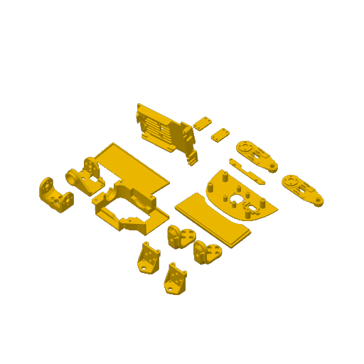

# 飞特 HD1910 机械资料

2026-10-11 同步。以下下载均在本仓库或本仓库 Releases，无需转到其他作者仓库。

图纸作者：**机械行者Robo**；原发布维护：fanhao375；基于 Pollen Robotics Microduck 模型。采用 **CC BY-NC-SA 4.0**，保留署名、非商业使用、相同方式共享。见[许可全文](../licenses/LICENSE-CC-BY-NC-SA-4.0.txt)与[来源记录](../SOURCES.md)。本项目负责整理，不将上游图纸宣称为原创。

## 下载

| 资料 | 本仓库入口 | 版本说明 |
|---|---|---|
| 完整 SolidWorks | [全套 ZIP](https://github.com/FromAIToReality/OpenMicroDuck/releases/download/cad-ft-v2.1/SolidWorks-FT2026-09-25.zip) | 17 个装配体、43 个零件；包未变，已核对哈希 |
| STEP 改动件 | [逐件下载](step/) · [11 件 ZIP](https://github.com/FromAIToReality/OpenMicroDuck/releases/download/cad-ft-v2.1/STEP-changed-parts-FT-2026-09-30.zip) | 2026-09-30，不是整机全套 STEP |
| 拓竹打印工程 | [3MF](print/microduck-FT-BambuStudio-20260930.3mf) | 9 月 30 日文件原样导入 |
| 装配说明 | [PDF](assembly/microduck装配安装说明书.pdf) | 21 页；移除末页推广二维码及关注提示，补充署名 |
| 装配 BOM | [Excel](BOM/装配BOM-20260929-无外链.xlsx) | 去除购物外链、拼团推广，规格及历史价格保留 |
| 组件及爆炸图 | [全部图片](components/) | 24 张 |

## 使用边界

- 新 STEP 包新增面部 FT1 变体，适配瑞莎原版摄像头孔距；仍须核对实物。
- SolidWorks 全套仍是 9 月 25 日版本，不能视为包含 9 月 30 日新增面部 STEP。
- 读取当前 3MF 确认：**P2S、0.4 mm、0.2 mm 层高、两个 PLA 配置、6 个盘位**。不是本项目已验证的 PA6-CF / TPU 参数。
- 预览直接提取自当前 3MF，不沿用上游 README 的旧五盘图。是否覆盖全部新版 CAD，尚未逐件验证。
- 合体轮胎为轮滑变体 TPU 件，普通步行版不必增加打印；不要混用 XL330 与飞特配合件。
- ZIP CRC 与文件哈希已检查，未在 SolidWorks 中重建全部装配体，未完成实机装配验证。

## 当前盘位预览

| 盘 1 | 盘 2 | 盘 3 |
|---|---|---|
|  |  |  |
| 盘 4 | 盘 5 | 盘 6 |
|  |  |  |

上游固定提交：`c9a533bc1206d8899950a5d466965a992d7e052a`。见[同步清单与哈希](../provenance/cad-refresh-20261011.json)。旧版由 Git 历史及本地备份保留，当前下载入口使用新版。
