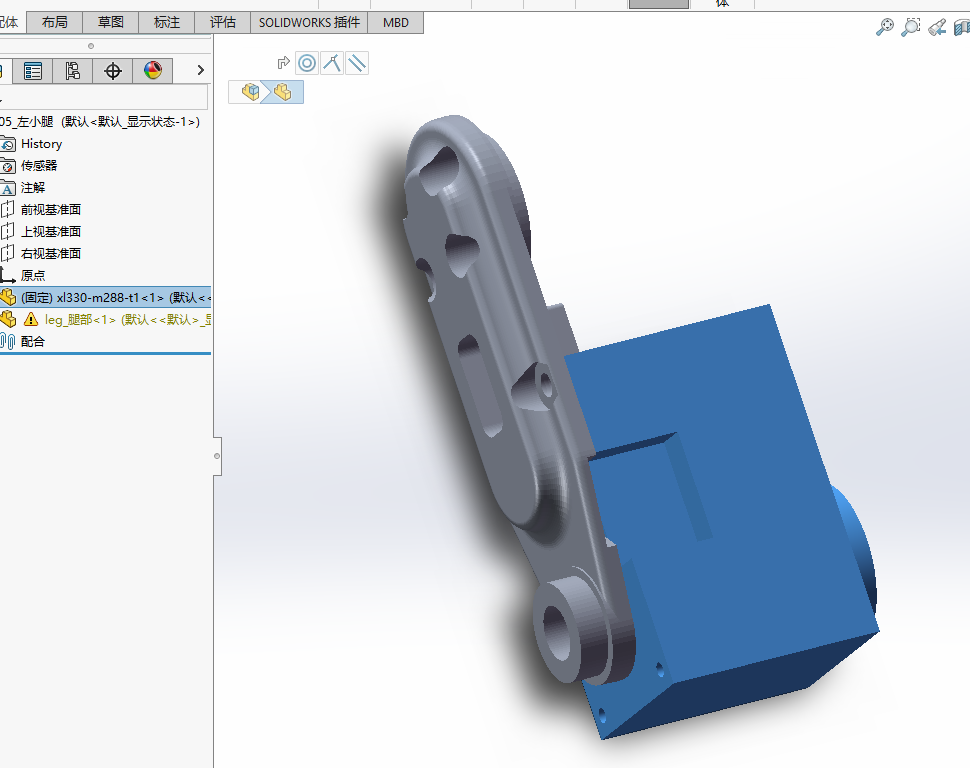
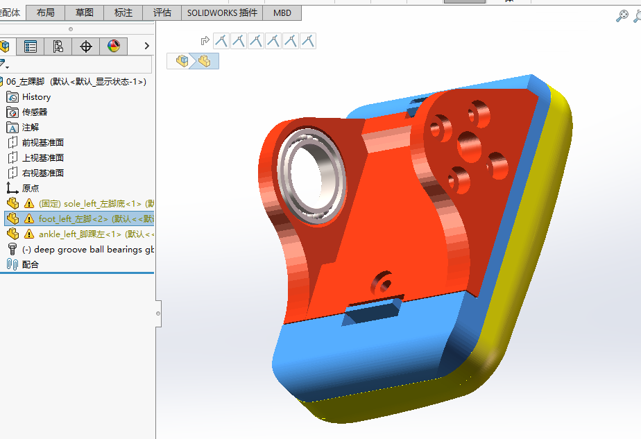
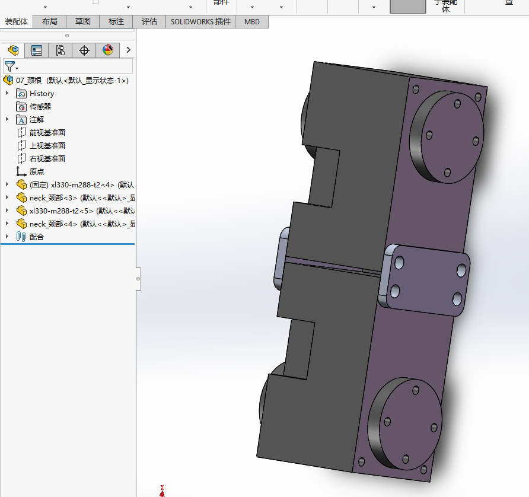
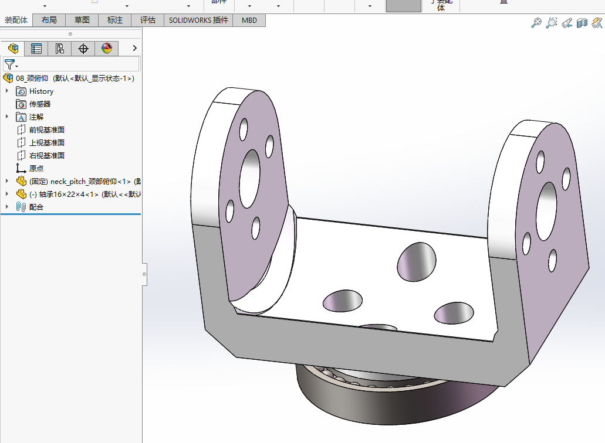
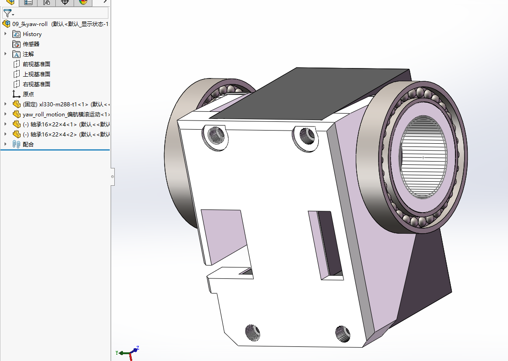
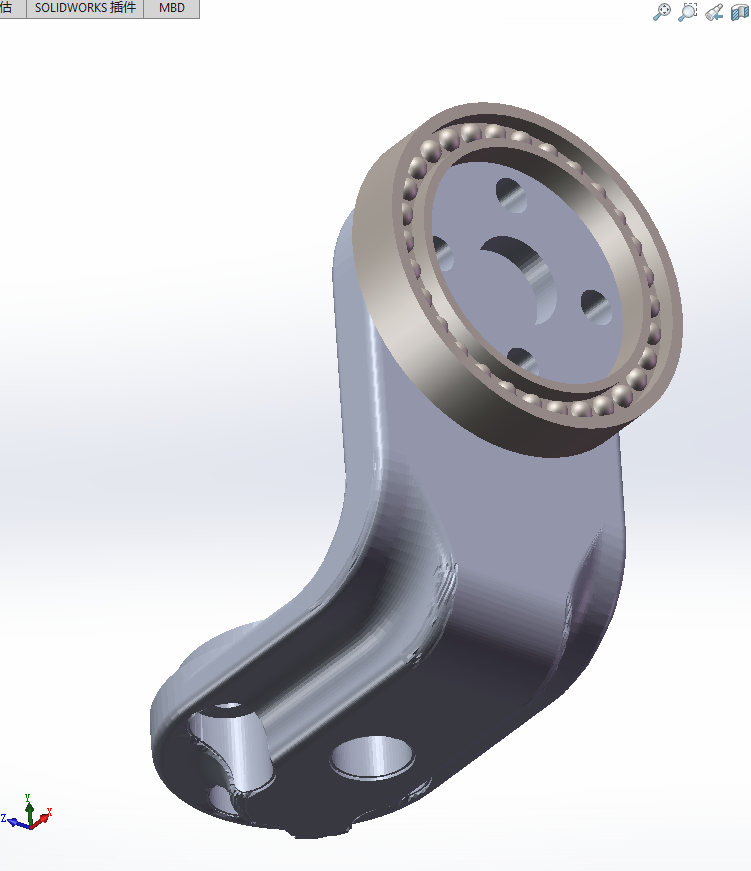
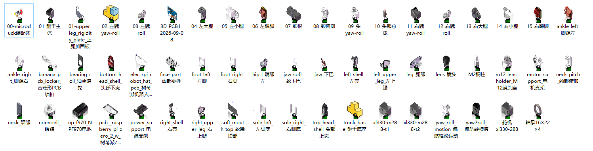

# Microduck CAD、打印与装配资料

2026-10-11 按本地整理版更新。以下下载均在本仓库或本仓库 Releases，无需转到其他作者仓库。

图纸作者：**机械行者Robo**；原发布维护：fanhao375；基于 Pollen Robotics Microduck 模型。采用 **CC BY-NC-SA 4.0**，保留署名、非商业使用、相同方式共享。见[许可全文](../licenses/LICENSE-CC-BY-NC-SA-4.0.txt)与[来源记录](../SOURCES.md)。本项目负责整理，不将上游图纸宣称为原创。

## 下载

| 资料 | 本仓库入口 | 版本说明 |
|---|---|---|
| 飞特 v2.1 完整 SolidWorks | [全套 ZIP](https://github.com/FromAIToReality/OpenMicroDuck/releases/download/cad-ft-v2.1/SolidWorks-FT2026-09-25.zip) | 17 个装配体、43 个零件；包未变，已核对哈希 |
| STEP 改动件 | [逐件下载](step/) · [11 件 ZIP](https://github.com/FromAIToReality/OpenMicroDuck/releases/download/cad-ft-v2.1/STEP-changed-parts-FT-2026-09-30.zip) | 2026-09-30，不是整机全套 STEP |
| 拓竹打印工程 | [3MF](print/microduck-FT-BambuStudio-20260930.3mf) | 9 月 30 日文件原样导入 |
| 装配说明 | [PDF](assembly/microduck装配安装说明书.pdf) | 21 页；移除末页推广二维码及关注提示，补充署名 |
| 装配 BOM | [Excel](BOM/装配BOM.xlsx) | 去除购物外链、拼团推广，规格及历史价格保留 |
| 组件及爆炸图 | [全部图片](components/) | 24 张 |

## 完整发布附件

[全部 7 个附件及校验值](releases/README.md)：含飞特 v2.1、v2.0 和 XL330 v1.1、v1.0。当前飞特工程优先使用 v2.1；XL330 请使用对应零件。历史版本仅供对照。

## 版本与使用说明

- 新 STEP 包新增面部 FT1 变体，适配瑞莎原版摄像头孔距；仍须核对实物。
- SolidWorks 全套仍是 9 月 25 日版本，不能视为包含 9 月 30 日新增面部 STEP。
- 读取当前 3MF 确认：**P2S、0.4 mm、0.2 mm 层高、两个 PLA 配置、6 个盘位**。不是本项目已验证的 PA6-CF / TPU 参数。
- 预览直接提取自当前 3MF，不沿用上游 README 的旧五盘图。是否覆盖全部新版 CAD，尚未逐件验证。
- 合体轮胎为轮滑变体 TPU 件，普通步行版不必增加打印；不要混用 XL330 与飞特配合件。
- ZIP CRC 与文件哈希已检查，未在 SolidWorks 中重建全部装配体，未完成实机装配验证。

## 当前盘位预览

| 盘 1 | 盘 2 | 盘 3 |
|---|---|---|
|  |  |  |
| 盘 4 | 盘 5 | 盘 6 |
|  |  |  |


---

以下版本差异、零件表和装配说明来自本地整理资料；其中历史测试描述属于原资料记录，不代表本项目已完成实机验证。BOM 价格仅供历史参考。

## 飞特 HD-1910 版改了什么

原版用 Dynamixel XL330，本项目采用飞特 HD-1910（更便宜、力矩大 2.5 倍、电压额定匹配 —— 见[主仓执行器选型](../docs/执行器选型.md)）。
**两款舵机外形接近但舵盘不一样：HD-1910 的舵盘是凸出来的，XL330 是凹进去的。** 所有跟舵盘配合的件都得改：

| 改动件                                       | 为什么                           |
| ----------------------------------------- | ----------------------------- |
| `left_upper_leg` / `right_upper_leg` 左右上腿 | 髋 pitch 和膝的舵盘位                |
| `leg` 小腿                                  | 膝和踝的舵盘位                       |
| `trunk_base` 躯干底座                         | 髋 yaw 舵机安装位                   |
| `yaw2roll` 偏航转横滚                          | 髋 yaw 舵盘 → 髋 roll 舵机          |
| `bearing_roll` 轴承滚轮                       | 髋 roll 轴承座                    |
| `01-upper_leg_rigidity_plate` 上腿加固板       | 跟上腿一起改                        |
| `99-yaw_roll_motion` 偏航横滚运动               | 头部 yaw/roll，`-F` 和 `-FT` 两个变体 |

**文件命名**：所有件带 `-FT` 后缀（FT = 飞特）。没改的件也带 `-FT`，是为了整套装配体引用一致 —— 27 个件跟 v1.0 内容一样，只是改了名。

**多出来的**：`HD-1910-c001-dan / -shuang`（单盘 / 双盘舵机模型）、`舵机比较.SLDASM`（两款舵机并排对比）、`飞特电机资料1/`（飞特给的 STEP / DWG / 规格图）。

⚠️ 装配说明书 PDF 和组件图**还是 v1.0 的**，装配顺序和步骤不变，只是舵机换了。

---

## 飞特 v2.1 改了什么（2026-09-25）

- **`rim_轮辋` 和 `tire_轮胎` 合并为 `合体轮胎`**：两个独立件组装困难，删除后合成一个「合体轮胎」，材料 **TPU**。
- 全套 SolidWorks 现在是 **60 个**（17 装配体 + 43 零件）；改动件 STEP 增到 **10 个**（新增 `合体轮胎.STEP`）。

---

## 面部零件适配瑞莎原版摄像头（2026-09-30）

- **`face_part_面部零件` 新增 `-FT1` 变体**：把摄像头安装孔距改成能直接装**瑞莎（Radxa）原版摄像头**。
- 改动件 STEP 包相应新增 **`face_part_面部零件-FT1适配瑞莎原版摄像头 改了孔距.STEP`**，由 10 个增到 **11 个**。

---

## XL330 原版 v1.1 改了什么（2026-09-15）

飞特版改踝、小腿、脚那一片时顺手把原版也改了，两版这一区域现在是同一套设计：

```
改了   05_左小腿 · 06_左踝脚 · 14_右小腿 · 15_右踝脚 · 10_头部总成
       ankle_left 脚踝左 · foot_left 左脚 · leg 腿部
新增   deep groove ball bearings gb（轴承模型）
改名   00-microduck装配体 → 00-microduck装配体 XL330-288舵机版本
       ankle_right_脚踝右 → ankle_right脚踝右
```

46 个件跟 v1.0 一样。

---

| 表里          | 这里              | 依据                                                        |
| ----------- | --------------- | --------------------------------------------------------- |
| 合体轮胎 / 滚轮叶片 | 标为**轮滑变体，走路不用** | 原 CAD 中的轮滑变体，只有做轮滑功能才打                                     |
| 合体轮胎材料写 PLA | 实际应打 **TPU**    | v2.1 合体轮胎是 TPU 软料，见[飞特 v2.1 改了什么](#飞特-v21-改了什么2026-09-25) |

### 一、3D 打印件（33 项）

| #   | 零件         | 文件                         | 材料      | 数量  | 备注                            |
| --- | ---------- | -------------------------- | ------- | --- | ----------------------------- |
| 1   | 头部上壳       | `top_head_shell`           | PLA     | 1   |                               |
| 2   | 头部下壳       | `bottom_head_shell`        | PLA     | 1   |                               |
| 3   | 面部零件       | `face_part`                | PLA     | 1   |                               |
| 4   | 下巴         | `jaw`                      | PLA     | 1   |                               |
| 5   | 软下巴        | `jaw_soft`                 | **TPU** | 1   | 软性件                           |
| 6   | 软嘴顶部       | `soft_mouth_top`           | **TPU** | 1   | 软性件                           |
| 7   | 眼睛         | `noenoeil`                 | PLA     | 1   |                               |
| 8   | 颈部         | `neck`                     | PLA     | 2   | 可换铝合金增强                       |
| 9   | 颈部俯仰       | `neck_pitch`               | PLA     | 1   |                               |
| 10  | 躯干底座       | `trunk_base`               | PLA     | 1   | 可换铝合金增强                       |
| 11  | 左壳         | `left_shell`               | PLA     | 1   |                               |
| 12  | 右壳         | `right_shell`              | PLA     | 1   |                               |
| 13  | 髋部左        | `hip_l`                    | PLA     | 2   |                               |
| 14  | 偏航转横滚      | `yaw2roll`                 | PLA     | 1   |                               |
| 15  | 偏航横滚运动     | `yaw_roll_motion`          | PLA     | 1   |                               |
| 16  | 腿部         | `leg`                      | PLA     | 2   |                               |
| 17  | 左上腿        | `left_upper_leg`           | PLA     | 1   |                               |
| 18  | 右上腿        | `right_upper_leg`          | PLA     | 1   |                               |
| 19  | 上腿加固板      | `upper_leg_rigidity_plate` | PLA     | 2   | 可换铝合金增强                       |
| 20  | 左脚         | `foot_left`                | PLA     | 1   |                               |
| 21  | 右脚         | `foot_right`               | PLA     | 1   |                               |
| 22  | 左脚底        | `sole_left`                | PLA     | 1   |                               |
| 23  | 右脚底        | `sole_right`               | PLA     | 1   |                               |
| 24  | 脚踝左        | `ankle_left`               | PLA     | 1   |                               |
| 25  | 脚踝右        | `ankle_right`              | PLA     | 1   |                               |
| 26  | 脚踝左 V1     | `ankle_l_v1`               | PLA     | 1   | 备选，与 24 二选一                   |
| 27  | 脚踝右 V1     | `ankle_r_v1`               | PLA     | 1   | 备选，与 25 二选一                   |
| 28  | 合体轮胎       | `合体轮胎`                     | **TPU** | 4   | **轮滑变体，走路不用**；v2.1 把轮辋 + 轮胎合并 |
| 29  | 滚轮叶片       | `roller_blade`             | PLA     | 2   | **轮滑变体，走路不用**                 |
| 30  | 电机支架       | `motor_support`            | PLA     | 1   |                               |
| 31  | 电源支架       | `power_support`            | PLA     | 1   |                               |
| 32  | 香蕉形 PCB 锁扣 | `banana_pcb_locker`        | PLA     | 1   |                               |
| 33  | 轴承滚轮       | `bearing_roll`             | PLA     | 2   | 可换铝合金增强                       |

### 二、外购件（21 项）

| #   | 件                  | 数量  | 单价(元) | 备注（历史参考价格）                                                                                                  |
| --- | ------------------ | --- | ----- | ---------------------------------------------------------------------------------------------------------- |
| 34  | Radxa Zero 3W 主控   | 1   | 309   |                                         |
| 35  | 64GB TF 卡          | 1   | 60    |                                                                                                            |
| 36  | RPI Robot HAT 电路板  | 1   | —     | 官方开源，嘉立创打样；或[不打 HAT 飞线](../docs/不打HAT.md)          |
| 37  | imu_to_dxl 电路板     | 1   | —     | 上游设计，[hardware/imu_to_dxl](../hardware/imu_to_dxl/) |
| 38  | 飞特 HD1901M 舵机      | 15  | —     | 型号须核对： **HD-1910-C001**                                 |
| 39  | 飞特舵机 URT2 调试板      | 1   | 45    |                     |
| 40  | NP-F550 电池         | 1   | 17    | 2S；                |
| 41  | 电池座                | 1   | 83    |                    |
| 42  | 2.5mm 香蕉插头 PCB 铜镀金 | 2   | 1.6   |                   |
| 43  | banana PCB         | 1   | —     | 嘉立创                                                                                                        |
| 44  | IMX219 摄像头模块       | 1   | 46.8  |                                        |
| 45  | VL53L8CX ToF 模块    | 1   | 49.5  |                     |
| 46  | 扬声器                | 1   | 3.8   | 走 HAT 音频才要；         |
| 47  | 轴承 10×15×3         | 3   | 2.8   |                                         |
| 48  | 轴承 16×22×4         | 11  | 3.5   |                     |
| 49  | 轴承 6×12×3          | 4   | 0.88  | 轮滑变体用，走路不用买；        |
| 50  | 螺丝 M2×5            | 1 包 | 3.05  |                    |
| 51  | 螺丝 M2×6            | 1 包 | 4.05  |                |
| 52  | 螺丝 M2.5×6          | 1 包 | 3.93  |                |
| 53  | 螺丝 M2.5×8          | 1 包 | 2.08  |                |
| 54  | 乐泰螺纹胶 243          | 1   | 9     |                   |

---

---

## 组件清单（15 个）

| 序号  | 组件           | 英文                 | 位置 / 功能                           |
| --- | ------------ | ------------------ | --------------------------------- |
| 01  | 躯干主体         | Torso              | 机身主体，**全部组件的装配基准件**，承载左/右腿、颈部与控制器 |
| 02  | 左髋           | Left Hip           | 左腿根部髋关节（Pitch），腿部前后摆动             |
| 03  | 左髋 Roll      | Left Hip Roll      | 左腿髋部横滚关节，腿部侧向摆动                   |
| 04  | 左大腿          | Left Thigh         | 连接髋关节与小腿                          |
| 05  | 左小腿          | Left Calf          | 连接大腿与踝关节                          |
| 06  | 左踝脚          | Left Ankle & Foot  | 踝关节及脚部，足部转动与支撑                    |
| 07  | 颈根           | Neck Base          | 颈部与机身连接处的旋转底座（Yaw）                |
| 08  | 颈俯仰          | Neck Pitch         | 颈部俯仰摆动关节                          |
| 09  | 头 Yaw / Roll | Head Yaw / Roll    | 头部水平摆动与横滚关节                       |
| 10  | 头部总成         | Head Assembly      | 头部完整组件，含外壳、摄像头等                   |
| 11  | 右髋           | Right Hip          | 与 02 镜像对称                         |
| 12  | 右髋 Roll      | Right Hip Roll     | 与 03 镜像对称                         |
| 13  | 右大腿          | Right Thigh        | 与 04 镜像对称                         |
| 14  | 右小腿          | Right Calf         | 与 05 镜像对称                         |
| 15  | 右踝脚          | Right Ankle & Foot | 与 06 镜像对称                         |

## 装配顺序

**按编号 01 → 15 依次装，就是推荐的整机装配顺序：**

```
1.  01           躯干主体 —— 作为整机基准先行固定
2.  02 → 06      左腿   左髋 → 左髋Roll → 左大腿 → 左小腿 → 左踝脚
3.  07 → 10      颈头   颈根 → 颈俯仰 → 头Yaw/Roll → 头部总成
4.  11 → 15      右腿   右髋 → 右髋Roll → 右大腿 → 右小腿 → 右踝脚
```

**每一步的详细步骤、配图和注意事项，见** [装配安装说明书 PDF](assembly/microduck装配安装说明书.pdf)。

---

## 组件图

<table>
<tr>
<td align="center"><br><sub><b>01</b> 躯干主体</sub></td>
<td align="center"><br><sub><b>02</b> 左髋</sub></td>
<td align="center"><br><sub><b>03</b> 左髋 Roll</sub></td>
<td align="center"><br><sub><b>04</b> 左大腿</sub></td>
</tr>
<tr>
<td align="center"><br><sub><b>05</b> 左小腿</sub></td>
<td align="center"><br><sub><b>06</b> 左踝脚</sub></td>
<td align="center"><br><sub><b>07</b> 颈根</sub></td>
<td align="center"><br><sub><b>08</b> 颈俯仰</sub></td>
</tr>
<tr>
<td align="center"><br><sub><b>09</b> 头 Yaw/Roll</sub></td>
<td align="center"><br><sub><b>10</b> 头部总成</sub></td>
<td align="center"><br><sub><b>11</b> 右髋</sub></td>
<td align="center"><br><sub><b>12</b> 右髋 Roll</sub></td>
</tr>
<tr>
<td align="center"><br><sub><b>13</b> 右大腿</sub></td>
<td align="center"><br><sub><b>14</b> 右小腿</sub></td>
<td align="center"><br><sub><b>15</b> 右踝脚</sub></td>
<td align="center"><br><sub>头部总成（爆炸）</sub></td>
</tr>
</table>

<div align="center">
  <br>
  <sub>全部零件总览</sub>
</div>

---

## XL330 早期版本文件清单（历史参考）

### 装配体（16 个 `.SLDASM`）

`00-microduck装配体` 是总装，下面 15 个是分组件：

```
00-microduck装配体      70.3 MB      08_颈俯仰               0.3 MB
01_躯干主体             20.5 MB      09_头yaw-roll          0.7 MB
02_左髋yaw-roll         2.5 MB      10_头部总成             22.2 MB
03_左髋roll             3.8 MB      11_右髋yaw-roll         2.5 MB
04_左大腿               1.9 MB      12_右髋roll             3.8 MB
05_左小腿               1.9 MB      13_右大腿               2.0 MB
06_左踝脚               9.3 MB      14_右小腿               1.8 MB
07_颈根                 0.1 MB      15_右踝脚               9.3 MB
```

### 零件（40 个 `.SLDPRT`）

| 类别           | 零件                                                                                                                                                                      |
| ------------ | ----------------------------------------------------------------------------------------------------------------------------------------------------------------------- |
| **躯干 / 外壳**  | `trunk_base_躯干底座` · `left_shell_左壳` · `right_shell_右壳` · `power_support_电源支架` · `banana_pcb_locker_香蕉形PCB锁扣`                                                            |
| **腿**        | `leg_腿部` · `left_upper_leg_左上腿` · `right_upper_leg_右上腿` · `hip_l_髋部左` · `yaw2roll_偏航转横滚` · `yaw_roll_motion_偏航横滚运动` · `01-upper_leg_rigidity_plate_上腿加固板`               |
| **踝 / 脚**    | `ankle_left_脚踝左` · `ankle_right_脚踝右` · `foot_left_左脚` · `foot_right_右脚` · `sole_left_左脚底` · `sole_right_右脚底`                                                            |
| **颈 / 头**    | `neck_颈部` · `neck_pitch_颈部俯仰` · `top_head_shell_头部上壳` · `bottom_head_shell_头部下壳` · `face_part_面部零件` · `jaw_下巴` · `jaw_soft_软下巴` · `soft_mouth_top_软嘴顶部` · `noenoeil_眼睛` |
| **摄像头**      | `m12_lens_holder_M12镜头座` · `lens_镜头`                                                                                                                                    |
| **电路板**      | `3D_PCB1_2026-09-08`（imu_to_dxl，2026-09-08 版）· `elec_rpi_robot_hat_pcb_树莓派机器人HAT电路板` · `pcb__raspberry_pi_zero_2_w_树莓派Zero2W电路板`                                        |
| **标准件 / 外购** | `舵机xl330-288` · `xl330-m288-t1` · `xl330-m288-t2` · `轴承16×22×4` · `bearing_roll_轴承滚轮` · `M2铜柱` · `motor_support_电机支架` · `np_f970_NPF970电池`                              |

### 两处命名要留意

- **`np_f970_NPF970电池`** —— 文件名沿用了上游的 `np_f970`，但**实物是 NP-F550**。
  上游记录的网格包围盒为 **70.8 × 38.6 × 20.6 mm**，正是 F550/F570 的尺寸；真 NP-F970 厚约 60 mm，
  **买错装不进去，而且 300 g 会吃掉整机预算的三分之一**。详见
  [本仓库硬件清单](../docs/hardware.md)。
- **`pcb__raspberry_pi_zero_2_w`** —— 同样是上游的占位命名，**实机主控是 Radxa Zero 3W**（RK3566），
  只是外形同为 Pi Zero。见[本仓库硬件方案参考](../docs/硬件方案逆向.md)。

---

## 通用注意事项（摘自说明书）

- 装配前对照 BOM 清点零件数量与规格，确认 **M2 / M2.5** 螺丝与紧固件齐全
- **舵机类关节件：装配前先通电归中位再锁紧**，避免行程偏移
- 螺丝**对角分步预紧**，避免单边受力导致零件变形；塑料件切勿过度锁紧
- **左右对称件（髋 / 大腿 / 小腿 / 踝脚）务必区分左右**，切勿装反
- 线缆统一固定、预留关节活动余量，严禁压线、夹线、缠绕
- 每完成一个活动关节，转动测试一次，检查是否干涉、卡滞、异响
- 首次通电前检查所有电气连接、绝缘与极性

**推荐工具**：十字/内六角螺丝刀 · 镊子 · 螺纹胶 · 舵机中位调试工具或控制板。

---

## 来源与许可

图纸作者：机械行者Robo；原发布维护：fanhao375/microduck-replica-cad。CC BY-NC-SA 4.0。整理版修复文件链接、移除推广入口并更新版本说明，详见[来源记录](../SOURCES.md)。
